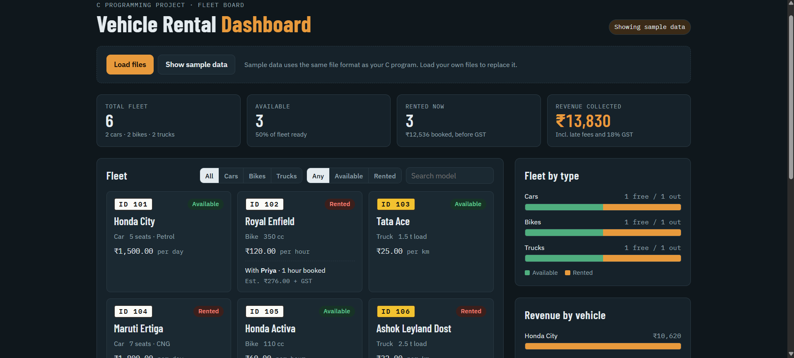
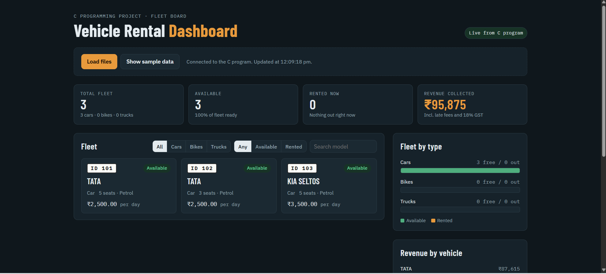
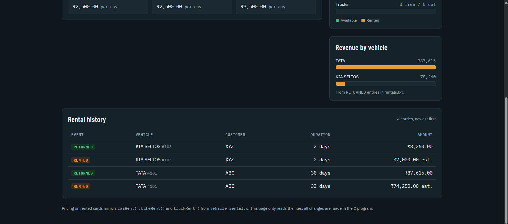
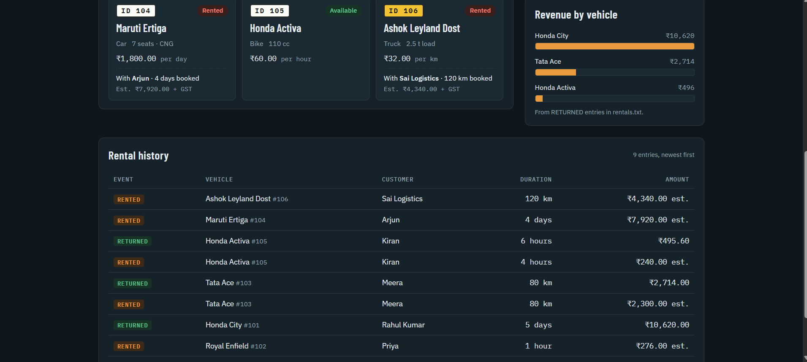
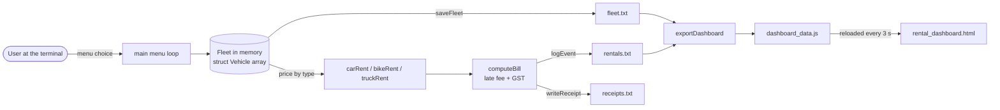

<div align="center">

# Vehicle Rental Management System

**A menu-driven rental shop for cars, bikes and trucks, written in C, with a browser dashboard that updates live as the program runs.**




</div>

---

## The problem

A small rental shop keeps three kinds of vehicles, and each one is charged differently. Cars go by the day, bikes by the hour and trucks by the kilometre. Each kind also carries different details: seats and fuel for a car, engine size for a bike, load capacity for a truck.

> How do you store vehicles that share most fields but differ in a few, price each one by its own rule, and keep every record safe after the program closes, using only standard C?

This project answers that with a tagged `union`, an array of function pointers and plain text files. A separate web page then turns those files into a live display.

---

## What it does

| | Feature | How |
|---|---|---|
| 🚗 | **Fleet management** | Add, view, search and sort vehicles. The fleet grows with `calloc` and `realloc` as you add more |
| 🧾 | **Rent and return with bills** | Each type is priced by its own function. Late returns add a 1.5× fee, and 18% GST is applied |
| 🔍 | **Search** | Recursive binary search by ID, and partial name search with `strstr` |
| 📊 | **Revenue report** | Fleet mix, vehicles out right now, and total revenue |
| 💾 | **Saves everything** | `fleet.txt`, `rentals.txt` and `receipts.txt` are written after every change and reloaded at start |
| 🖥️ | **Live dashboard** | A browser page that refreshes every 3 seconds and highlights vehicles as they are added, rented or returned |
| 🎬 | **Demo data** | Menu option 12 loads 6 vehicles and 9 history entries in one step, so a demo never starts empty |

<table>
  <tr>
    <td width="50%"></td>
    <td width="50%"></td>
  </tr>
  <tr>
    <td align="center"><sub>Connected live to the C program: vehicles added from the terminal</sub></td>
    <td align="center"><sub>Rentals and returns logged to rentals.txt, with revenue per vehicle</sub></td>
  </tr>
</table>

<p align="center">
  <br>
  <sub>Demo data (menu option 12): rented vehicles with booking estimates, and the full rental history</sub>
</p>

---

## How it works



The C program is the only place where data changes. The dashboard only reads.

Browsers block web pages from reading local `.txt` files, but they do allow a page to load a local script. So after every save, `exportDashboard()` copies both text files into `dashboard_data.js`, and the page reloads that script every 3 seconds.

### Pricing rules

| Type | Charged per | Function | Rules |
|---|---|---|---|
| Car | day | `carRent()` | +10% for more than 5 seats, 10% off for 7 or more days |
| Bike | hour | `bikeRent()` | 2-hour minimum, +15% above 300 cc |
| Truck | km | `truckRent()` | Rate × km, plus ₹200 per ton of load capacity |

**Every bill:** late units × rate × 1.5, then 18% GST on the total.

The right function is chosen through an array of function pointers, with no `if-else` chain:

```c
float (*pricing[3])(struct Vehicle *, int) = { carRent, bikeRent, truckRent };

estimate = pricing[typeIndex(v->type)](v, units);
```

### One struct, three shapes

A vehicle uses only one set of type-specific details, so they share memory in a union. The `type` field records which member is valid.

```c
union VehicleDetails {
    struct { int seats; char fuel[10]; } car;
    struct { int engineCC; }            bike;
    struct { float loadTons; }          truck;
};
```

---

## Syllabus coverage

Every topic in the four course modules is used where it fits the problem, not added just to tick a box. A full concept-to-function map is in the comment block at the top of [`vehicle_rental.c`](vehicle_rental.c).

| Module | Concept | Where it is used |
|---|---|---|
| **1. Introduction to C** | Constants, expressions, operators | `#define` limits, `const GST_RATE`, bill arithmetic |
| | Operator precedence | `truckRent()`: `rate * km + loadTons * 200` |
| | Selection, logical operators, loops | `switch` menu, `do-while` input checks, `continue` in `displayAvailable()` |
| | Debugging | `DEBUG` flag, plus notes on syntax, runtime and logical errors at the end of the file |
| **2. Arrays and functions** | Call by value / by reference | `calcGST(float)` / `markRented(struct Vehicle *)` |
| | Scope and `static` | Global fleet, local variables, `static receiptNo` |
| | Recursion | `searchById()` binary search, `countAvailable()` |
| | Strings | `strcpy`, `strcat`, `strcmp`, `strlen`, `strstr`; `replaceSpaces(char *)` |
| **3. Pointers and memory** | Pointer arithmetic | `for (p = fleet; p < fleet + count; p++)` |
| | Pointers and arrays | `fleet[mid]`, `*(fleet + mid)` and `fleet + mid` in `searchById()` |
| | `malloc`, `calloc`, `realloc`, `free` | `ensureCapacity()`, `returnVehicle()`, `sortAndShow()` |
| | Function pointers | `pricing[]`, comparator passed to `bubbleSort()` |
| | NULL and dangling pointers | Every allocation and `fopen` checked; pointers set to `NULL` after `free` |
| **4. Structures, unions, files** | Structures | `struct Vehicle`, `struct Rental`, struct copy and swap |
| | Union | `union VehicleDetails` |
| | File handling | `fopen`, `fclose`, `fprintf`, `fscanf`, `fgets`, `fputs` |

---

## Run it locally

**Requirements:** a C compiler (GCC, or MinGW on Windows) and any web browser. Nothing else to install.

```bash
git clone https://github.com/tanishkagoswami/VehicleRental.git
cd VehicleRental
gcc vehicle_rental.c -o rental
```

```bash
./rental            # Windows: .\rental.exe
```

1. Choose **12** to load demo data.
2. Choose **11** to open the dashboard. Keep `rental_dashboard.html` in the same folder as the program.
3. Put the terminal and the browser side by side, then add, rent or return a vehicle. The dashboard updates within 3 seconds.

> To start over with an empty fleet, delete `fleet.txt`, `rentals.txt`, `receipts.txt` and `dashboard_data.js`.

### Try this

| Menu | Input | What you should see |
|---|---|---|
| 1 | `C`, `Hyundai Creta`, `2200`, `5`, `Diesel` | Car added as ID 107; the dashboard marks it **Just added** |
| 7 | `107`, `Ananya`, `2` | Estimated charge ₹4,400 + GST; the card turns **Rented** |
| 8 | `107`, `4` | Bill with a ₹6,600 late fee, total ₹12,980 |
| 4 | `999` | "No vehicle found", the NULL pointer case |
| 0 | | Data saved; run the program again and everything reloads |

---

## Data files

All files are plain text, so you can open them in any editor to see exactly what the program stored.

| File | Written by | Format |
|---|---|---|
| `fleet.txt` | `saveFleet()` | First line `nextId revenue count`, then one vehicle per line |
| `rentals.txt` | `logEvent()` | `RENTED \| ID 101 \| Honda_City \| Rahul_Kumar \| 3 day(s) \| Rs 4500.00` |
| `receipts.txt` | `writeReceipt()` | One printed bill per return |
| `dashboard_data.js` | `exportDashboard()` | Both text files as JavaScript string arrays |

```text
107 13829.60 6
101 Honda_City C 1500.00 1 0 - 5 Petrol
102 Royal_Enfield B 120.00 0 1 Priya 350
103 Tata_Ace T 25.00 1 0 - 1.50
```

Spaces in names are stored as underscores so `fscanf("%s")` can read them back.

---

## Project structure

```text
VehicleRental/
├── vehicle_rental.c        # the complete program, about 50 functions
├── rental_dashboard.html   # live dashboard, no libraries
├── docs/                   # screenshots used in this README
├── README.md
└── .gitignore              # keeps the compiled program and data files out of git
```

---

## Testing

- Compiles with `gcc -Wall -Wextra -std=c99` and **no warnings**.
- Demo data totals were checked against bills worked out by hand: revenue ₹13,829.60 across three returns.
- Persistence was checked by saving, restarting and comparing the reloaded fleet.
- Invalid input, such as letters at a number prompt or an unknown vehicle ID, is rejected without crashing.
- Names containing quotes are escaped before they reach `dashboard_data.js`, so the dashboard cannot break.

---

## Limitations

- **Single user at a time.** There is no locking if two copies of the program run in the same folder.
- **No dates.** Durations are entered by hand, because `time.h` is outside the course syllabus.
- **Receipt numbers restart each run.** They come from a `static` counter, which is kept on purpose to show `static` scope.
- **The dashboard is read-only.** Letting the page change data would need the C program to act as a web server using sockets, which is outside the syllabus.

## Roadmap

- [ ] Store rental start and end dates with `time.h`
- [ ] Delete or edit a vehicle from the menu
- [ ] Save the receipt counter to file so numbers continue across runs
- [ ] Split the code into `.c` and `.h` modules

---

<div align="center">

Built by **[Tanishka Goswami](https://github.com/tanishkagoswami)** · BTech CSE (AI/ML), VIT-AP University

<sub>C programming course project</sub>

</div>
